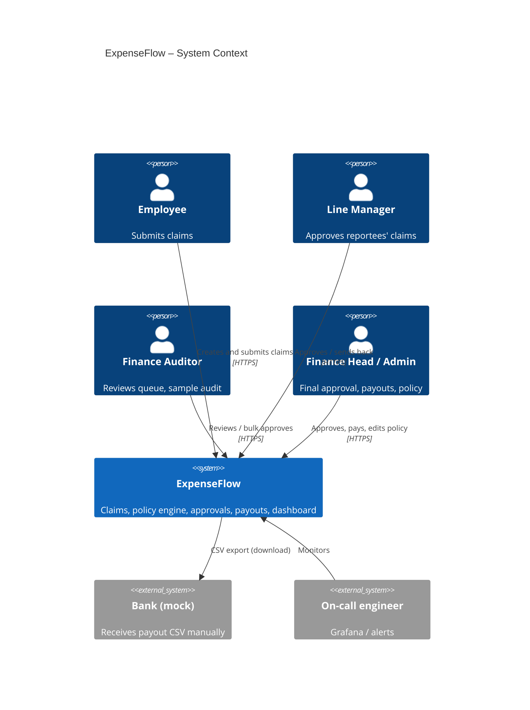
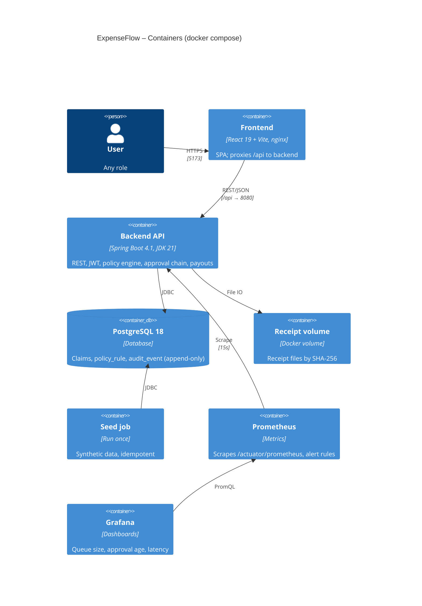
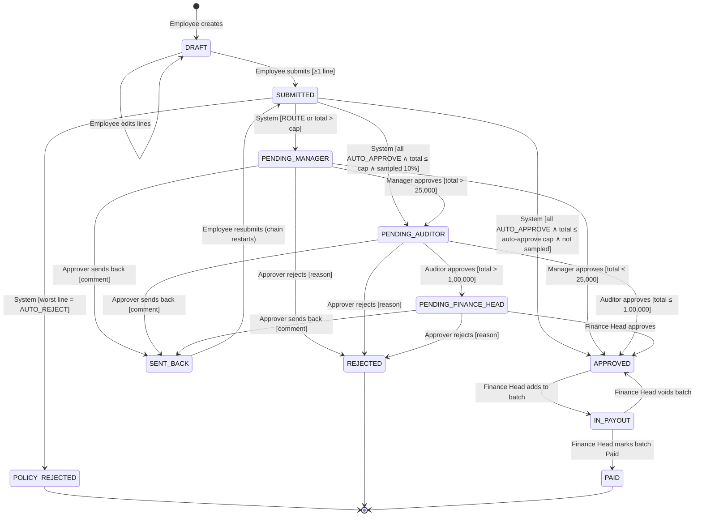

# ExpenseFlow — Low-Level Design (LLD)

**Owner:** P1 · **Status:** Draft v1 · **Related:** [CLAUDE.md](../CLAUDE.md), [ADR-001](ADR-001-approval-chains.md), [Auditor review](03-Auditor-Review.md)

---

## 1. Architecture

### 1.1 C4 Context


### 1.2 C4 Container


---

## 2. Claim state machine



"Approver" includes an active delegate of the step's assignee. In every case the guard `actor ≠ claim.owner` applies.

### 2.1 Transition table

| # | From | Event | Actor role | Guard | To | Audit action |
|---|---|---|---|---|---|---|
| T1 | — | create | EMPLOYEE (any user) | — | DRAFT | `CLAIM_CREATED` |
| T2 | DRAFT / SENT_BACK | edit line / upload receipt | Owner | state editable | same | `LINE_ADDED/UPDATED/REMOVED`, `RECEIPT_UPLOADED` |
| T3 | DRAFT | submit | Owner | ≥ 1 line; all mandatory fields | SUBMITTED | `CLAIM_SUBMITTED` |
| T4 | SUBMITTED | policy evaluated | SYSTEM | worst = AUTO_REJECT | POLICY_REJECTED | `POLICY_EVALUATED`, `CLAIM_POLICY_REJECTED` |
| T5 | SUBMITTED | policy evaluated | SYSTEM | worst = AUTO_APPROVE ∧ total ≤ cap ∧ ¬sampled | APPROVED | `POLICY_EVALUATED`, `CLAIM_AUTO_APPROVED` |
| T6 | SUBMITTED | policy evaluated | SYSTEM | worst = AUTO_APPROVE ∧ total ≤ cap ∧ sampled | PENDING_AUDITOR | `POLICY_EVALUATED`, `CLAIM_SAMPLED_FOR_AUDIT` |
| T7 | SUBMITTED | policy evaluated | SYSTEM | worst = ROUTE ∨ total > cap | PENDING_MANAGER | `POLICY_EVALUATED`, `APPROVAL_CHAIN_CREATED` |
| T8 | PENDING_MANAGER | approve | MANAGER of owner, or active delegate | actor ≠ owner; version match | PENDING_AUDITOR if total > 25,000, else APPROVED | `STEP_APPROVED` (+ `CLAIM_APPROVED`) |
| T9 | PENDING_AUDITOR | approve / bulk approve | AUDITOR or delegate | actor ≠ owner; version | PENDING_FINANCE_HEAD if total > 1,00,000, else APPROVED | `STEP_APPROVED` |
| T10 | PENDING_FINANCE_HEAD | approve | FINANCE_HEAD or delegate | actor ≠ owner | APPROVED | `STEP_APPROVED`, `CLAIM_APPROVED` |
| T11 | PENDING_* | send back | Current step approver | comment non-empty | SENT_BACK | `CLAIM_SENT_BACK` |
| T12 | PENDING_* | reject | Current step approver | reason non-empty | REJECTED | `CLAIM_REJECTED` |
| T13 | SENT_BACK | resubmit | Owner | ≥ 1 line | SUBMITTED → T4–T7 (old steps CANCELLED) | `CLAIM_RESUBMITTED` |
| T14 | APPROVED | add to batch | FINANCE_HEAD | not in another active batch | IN_PAYOUT | `PAYOUT_ITEM_ADDED` |
| T15 | IN_PAYOUT | void batch | FINANCE_HEAD | batch ≠ PAID | APPROVED | `PAYOUT_BATCH_VOIDED` |
| T16 | IN_PAYOUT | mark paid | FINANCE_HEAD | batch EXPORTED | PAID | `PAYOUT_BATCH_PAID` |
| T17 | any PENDING | comment | Owner / any approver who can see it | — | same | `COMMENT_ADDED` |

If the finance head owns the claim, the step goes to a configured alternate approver (`approval.alternate_finance_approver`). Self-approval is never allowed.

---

## 3. Policy as configuration

### 3.1 `policy_rule` schema
| Column | Type | Notes |
|---|---|---|
| id | BIGSERIAL PK | |
| rule_code | VARCHAR(50) | e.g. `MEAL_DAILY_LIMIT` |
| category | VARCHAR(20) NULL | MEAL, HOTEL, CAB, OTHER; NULL = all |
| city_tier | VARCHAR(10) NULL | TIER_1, OTHER; NULL = any |
| limit_amount | NUMERIC(14,2) NULL | |
| unit | VARCHAR(10) | PER_DAY, PER_NIGHT, PER_TRIP, PER_LINE, NONE |
| action | VARCHAR(15) | AUTO_APPROVE, ROUTE, AUTO_REJECT |
| flag | VARCHAR(20) NULL | OVER_LIMIT, DUPLICATE, WEEKEND, RECEIPT |
| params | JSONB | extra, e.g. `{"weekendDays":["SAT","SUN"]}` |
| active | BOOLEAN | |
| version | INT | increases per rule_code |
| effective_from | TIMESTAMPTZ | |
| created_by | BIGINT FK employee | |
| created_at | TIMESTAMPTZ | |

Unique key: `(rule_code, category, city_tier, version)`.

### 3.2 Loading and versioning
- The engine loads the **active rows with the highest version whose `effective_from` ≤ submit time**. Rows are cached for 30 s and the cache is evicted when a rule is saved.
- Editing a rule never updates a row in place. It inserts version N+1 and sets the old row's `active = false`. That flag is the only update allowed, and it runs in the same transaction.
- Each `policy_result` stores `rule_id` (and therefore the version), so any decision can be explained later.
- Every save writes `audit_event(action = POLICY_RULE_CHANGED, before = old row, after = new row)`.
- A finance head may not edit rules while they have a claim in `SUBMITTED` (see [auditor review](03-Auditor-Review.md), R7). Rule changes also need a reason.
- Rollback means inserting a new version that copies an earlier one, so history keeps moving forward.

### 3.3 Seed rows
| rule_code | category | city_tier | limit | unit | action | flag |
|---|---|---|---|---|---|---|
| MEAL_DAILY_LIMIT | MEAL | NULL | 1500.00 | PER_DAY | ROUTE | OVER_LIMIT |
| HOTEL_NIGHTLY_LIMIT | HOTEL | TIER_1 | 6000.00 | PER_NIGHT | ROUTE | OVER_LIMIT |
| HOTEL_NIGHTLY_LIMIT | HOTEL | OTHER | 4000.00 | PER_NIGHT | ROUTE | OVER_LIMIT |
| CAB_TRIP_LIMIT | CAB | NULL | 2000.00 | PER_TRIP | ROUTE | OVER_LIMIT |
| RECEIPT_REQUIRED | NULL | NULL | 500.00 | PER_LINE | AUTO_REJECT | RECEIPT |
| DUPLICATE_VENDOR_AMOUNT_DATE | NULL | NULL | NULL | NONE | ROUTE | DUPLICATE |
| DUPLICATE_RECEIPT_HASH | NULL | NULL | NULL | NONE | ROUTE | DUPLICATE |
| WEEKEND_SPEND | NULL | NULL | NULL | NONE | ROUTE | WEEKEND |

Other config (`app_config` key/value, versioned the same way): `auto_approve_max_total = 5000.00`, `sample_audit_rate = 0.10`, `sample_audit_seed = 42`.

### 3.4 `approval_threshold` table
| level | seq | min_total_exclusive | role |
|---|---|---|---|
| MANAGER | 1 | 0.00 | MANAGER (owner's manager) |
| AUDITOR | 2 | 25000.00 | AUDITOR (pool) |
| FINANCE_HEAD | 3 | 100000.00 | FINANCE_HEAD |

---

## 4. ERD

```mermaid
erDiagram
    department ||--o{ employee : has
    employee ||--o{ employee : manages
    employee ||--o{ delegation : delegator
    employee ||--o{ delegation : delegate
    employee ||--o{ claim : owns
    claim ||--|{ claim_line : contains
    claim_line ||--o| receipt : has
    claim_line ||--o{ policy_result : evaluated
    policy_rule ||--o{ policy_result : produced
    claim ||--o{ approval_step : routed
    claim ||--o{ comment : has
    claim ||--o{ audit_event : logs
    payout_batch ||--|{ payout_item : contains
    claim ||--o| payout_item : paid_in

    department { bigint id PK; varchar code; varchar name }
    employee { bigint id PK; varchar emp_code UK; varchar name; varchar email UK; bigint department_id FK; bigint manager_id FK; varchar roles; varchar bank_account_masked; varchar ifsc; boolean active }
    delegation { bigint id PK; bigint delegator_id FK; bigint delegate_id FK; date from_date; date to_date; varchar reason; boolean revoked; timestamptz created_at }
    claim { bigint id PK; varchar claim_no UK; bigint employee_id FK; varchar title; varchar status; numeric total_amount; boolean sample_audit; varchar policy_outcome; timestamptz submitted_at; timestamptz approved_at; int version; timestamptz created_at }
    claim_line { bigint id PK; bigint claim_id FK; varchar category; numeric amount; date expense_date; varchar vendor; varchar vendor_norm; varchar city; varchar city_tier; int nights; varchar description; varchar line_outcome }
    receipt { bigint id PK; bigint claim_line_id FK; varchar storage_key; varchar original_name; varchar content_type; bigint size_bytes; char sha256; timestamptz uploaded_at }
    policy_rule { bigint id PK; varchar rule_code; varchar category; varchar city_tier; numeric limit_amount; varchar unit; varchar action; varchar flag; jsonb params; boolean active; int version; timestamptz effective_from }
    policy_result { bigint id PK; bigint claim_line_id FK; bigint rule_id FK; varchar rule_code; varchar outcome; varchar flag; varchar reason; int evaluation_no; timestamptz evaluated_at }
    approval_step { bigint id PK; bigint claim_id FK; int seq; varchar level; bigint assignee_id FK; varchar status; bigint acted_by FK; bigint on_behalf_of FK; timestamptz acted_at; varchar note; int cycle_no }
    comment { bigint id PK; bigint claim_id FK; bigint author_id FK; varchar body; timestamptz created_at }
    audit_event { bigint id PK; varchar entity_type; bigint entity_id; varchar action; bigint actor_id; bigint on_behalf_of_id; jsonb before; jsonb after; varchar ip; varchar request_id; timestamptz created_at }
    payout_batch { bigint id PK; varchar batch_no UK; varchar status; int claim_count; numeric total_amount; varchar file_name; char file_sha256; bigint created_by FK; timestamptz exported_at; timestamptz paid_at }
    payout_item { bigint id PK; bigint batch_id FK; bigint claim_id FK; bigint employee_id FK; numeric amount }
```

**Key constraints and indexes**
- `claim_line(employee_id via claim, vendor_norm, amount, expense_date)`: index for the duplicate lookup.
- `receipt(sha256)`: index, not unique (duplicates must be stored so they can be flagged).
- `payout_item(claim_id)`: partial unique index where the batch is not VOIDED, so a claim sits in only one active batch.
- `approval_step(assignee_id, status)`, `claim(status, submitted_at)`, `claim(employee_id)`, `audit_event(entity_type, entity_id)`, `audit_event(actor_id, created_at)`.
- `CHECK (amount > 0)`, `CHECK (nights >= 1 OR category <> 'HOTEL')`, `CHECK (delegator_id <> delegate_id)`.
- Trigger `audit_event_no_mutation`: `BEFORE UPDATE OR DELETE ON audit_event … RAISE EXCEPTION 'audit_event is append-only'`. The app DB user is also granted only INSERT and SELECT on the table.

---

## 5. Module breakdown (backend packages)

| Package | Responsibility | Key classes |
|---|---|---|
| `common` | Errors (RFC 7807), security config, JWT, IST clock, money utils | `ProblemHandler`, `JwtService`, `SecurityConfig`, `ClockConfig` |
| `user` | Employees, departments, demo login, delegation | `AuthController`, `DelegationService`, `AccessPolicy` |
| `claim` | Claim + line CRUD, receipts, submit, state machine | `ClaimController`, `ClaimService`, `ReceiptStorage`, `ClaimStateMachine` |
| `policy` | Rule loading, engine, rule strategies, admin | `PolicyEngine`, `PolicyRule` (interface), `MealDailyLimitRule`, … `PolicyAdminController` |
| `approval` | Step generation, actions, inbox, auditor queue, sample audit | `ApprovalChainFactory`, `ApprovalService`, `AuditorQueueQuery`, `SampleAuditSelector` |
| `payout` | Batch lifecycle, CSV writer | `PayoutService`, `BankCsvWriter` |
| `audit` | Append-only writer, query API | `AuditWriter`, `AuditController` |
| `dashboard` | Aggregate queries | `DashboardController`, `DashboardRepository` |

---

## 6. REST API

Base path `/api`. Every endpoint except demo-login needs `Authorization: Bearer <jwt>`. Errors are `application/problem+json`.

| Method | Path | Roles | Request → Response | Errors |
|---|---|---|---|---|
| GET | /auth/demo-users | public | → list of {id, name, roles} | — |
| POST | /auth/demo-login | public | {employeeId} → {token, expiresAt, user} | 404, 429 |
| GET | /me | any | → user + roles + active delegations | 401 |
| GET | /claims?mine=true&status=&page= | any | → page of claim summaries (scoped) | 400 |
| POST | /claims | any | {title} → claim (DRAFT) | 400 |
| GET | /claims/{id} | scoped | → claim + lines + policy results + steps + comments | 404 |
| PATCH | /claims/{id} | owner | {title, version} → claim | 404, 409, 422 (state) |
| POST | /claims/{id}/lines | owner | {category, amount, expenseDate, vendor, city, cityTier, nights, description} → line | 404, 422 |
| PUT | /claims/{id}/lines/{lineId} | owner | same → line | 404, 409, 422 |
| DELETE | /claims/{id}/lines/{lineId} | owner | → 204 | 404, 422 |
| POST | /claims/{id}/lines/{lineId}/receipt | owner | multipart file → {receiptId, sha256} | 413, 415, 422 |
| GET | /receipts/{receiptId} | scoped | → file stream (Content-Disposition: attachment) | 404 |
| POST | /claims/{id}/policy-preview | owner | → per-line outcomes (dry run, no persistence) | 404 |
| POST | /claims/{id}/submit | owner | {version} → claim with new status + results | 404, 409, 422 |
| POST | /claims/{id}/approve | current approver | {version, note?} → claim | 403*, 404, 409 |
| POST | /claims/{id}/reject | current approver | {version, reason} → claim | 404, 409, 422 |
| POST | /claims/{id}/send-back | current approver | {version, comment} → claim | 404, 409, 422 |
| POST | /claims/{id}/comments | scoped | {body} → comment | 404 |
| GET | /approvals/inbox?sort=age | MANAGER, AUDITOR, FINANCE_HEAD, delegates | → pending steps, oldest first | — |
| GET | /auditor/queue?dept=&category=&min=&max=&flag=&sample=&ageDays=&sort=&page= | AUDITOR, FINANCE_HEAD | → page | 400 (bad sort) |
| POST | /auditor/bulk-approve | AUDITOR | {items:[{claimId, version}]} → [{claimId, result, error?}] | 400 (>100) |
| GET/POST | /delegations | MANAGER, AUDITOR, FINANCE_HEAD | {delegateId, fromDate, toDate, reason} → delegation | 422 (cycle, self, overlap) |
| DELETE | /delegations/{id} | delegator | → 204 (revoked) | 404 |
| GET | /payouts/eligible | FINANCE_HEAD | → APPROVED claims | — |
| POST | /payouts | FINANCE_HEAD | {claimIds} → batch (claims IN_PAYOUT) | 409 (already batched) |
| GET | /payouts/{id} | FINANCE_HEAD | → batch + items + totals | 404 |
| GET | /payouts/{id}/csv | FINANCE_HEAD | → text/csv file | 404 |
| POST | /payouts/{id}/mark-paid | FINANCE_HEAD | {version} → batch | 409, 422 (not exported) |
| POST | /payouts/{id}/void | FINANCE_HEAD | {reason} → batch | 422 (paid) |
| GET | /dashboard/spend-by-category?from=&to= | AUDITOR, FINANCE_HEAD, MANAGER (own team) | → [{category, total}] | — |
| GET | /dashboard/spend-by-department | same | → [{department, total}] | — |
| GET | /dashboard/spend-by-month | same | → last 12 months | — |
| GET | /dashboard/violations | same | → [{ruleCode, count}] | — |
| GET | /dashboard/approval-time | same | → [{department, avgHours}] | — |
| GET | /audit?claimId=&actorId=&from=&to=&page= | AUDITOR, FINANCE_HEAD; owner for own claim | → page of events | — |
| GET | /admin/policy-rules?includeHistory= | FINANCE_HEAD (read: AUDITOR) | → rules | — |
| POST | /admin/policy-rules/{ruleCode}/versions | FINANCE_HEAD | {limitAmount, action, active, effectiveFrom, reason} → new version | 422, 409 (has own claim in flight) |

\* 403 is returned only when the caller can see the claim but is not the current approver (e.g. the owner trying to approve). If the caller cannot see the claim at all, the response is 404.

### 6.1 RBAC matrix

| Capability | EMPLOYEE | MANAGER | AUDITOR | FINANCE_HEAD |
|---|---|---|---|---|
| Create, edit, submit own claim | ✅ | ✅ | ✅ | ✅ |
| View claims | own | own + reportees + delegated | all | all |
| Approve / reject / send back | — | reportees' (manager step) | auditor step | finance head step |
| Bulk approve | — | — | ✅ | — |
| Delegate | — | ✅ | ✅ | ✅ |
| Payout batches | — | — | — | ✅ |
| Dashboard | — | own team | all | all |
| Audit trail | own claims | reportees' claims | all | all |
| Policy rules | — | — | read | read/write |

The rule "never on own claim" overrides every cell in this table.

---

## 7. Policy engine algorithm

```text
evaluate(claim, at = now):
  rules   = ruleRepo.activeAt(at)                    // versioned rows
  history = lineRepo.nonDraftLinesFor(claim.employee) // for duplicates
  results = []
  for line in claim.lines (order by expense_date, id):
      for strategy in ORDERED_STRATEGIES:            // order below
          r = strategy.evaluate(line, claim, rules, history, results)
          if r != null: results.add(r)
      line.outcome = worst(results for line, default AUTO_APPROVE)
  claim.outcome = worst(line.outcome for all lines)
  persist policy_result rows (evaluation_no = previous + 1)
  return claim.outcome

ORDERED_STRATEGIES:
  1 RECEIPT_REQUIRED          amount > limit AND no receipt  → AUTO_REJECT "RECEIPT_REQUIRED"
  2 DUPLICATE_RECEIPT_HASH    receipt.sha256 seen on any other line → flag DUPLICATE
  3 DUPLICATE_VENDOR_AMOUNT_DATE  (vendor_norm, amount, date) seen earlier for same employee
                                  (in this claim at a lower line id, or in older non-draft claims)
  4 MEAL_DAILY_LIMIT          sum(MEAL lines same employee same date, incl. other submitted claims) > limit
  5 HOTEL_NIGHTLY_LIMIT       (amount / nights) > limit[city_tier]
  6 CAB_TRIP_LIMIT            amount > limit
  7 WEEKEND_SPEND             expense_date.dayOfWeek in params.weekendDays (IST)

worst(): AUTO_REJECT > ROUTE > AUTO_APPROVE
```

- Order affects only the order of explanations shown. Because the worst outcome wins, the final outcome does not depend on order.
- All strategies run, with no short-circuit, so the user sees every reason at once.
- Meal summing across claims stops an employee from splitting one day's meals over two claims.
- Comparisons use `BigDecimal.compareTo`, so `1500.00` passes and `1500.01` fails.

### 7.1 Duplicate detection
- `vendor_norm = lower(trim(collapse_spaces(remove_punctuation(vendor))))`.
- Vendor + amount + date matches within the same employee, against non-draft, non-policy-rejected claims plus earlier lines of the current claim.
- Receipt hash matches across **all** employees (catches two people claiming one bill).
- The SHA-256 is computed on the raw bytes at upload. If the metadata changes but the file bytes are the same, it is still a duplicate.
- A duplicate is a flag (ROUTE), not a rejection. The approver sees a link to the matching claim and line.

### 7.2 Sample-audit selection
- Runs only for claims that would be auto-approved (T5/T6).
- `selected = random.nextDouble() < sample_audit_rate`. `Random` is a Spring bean seeded from config in tests and from `SecureRandom` in prod.
- The decision is stored on `claim.sample_audit` with the audit action `CLAIM_SAMPLED_FOR_AUDIT`. The seed test asserts the rate is 10% ± 2% over 1,000 claims.

---

## 8. Payout CSV format

File name: `EXPF_<yyyyMMdd>_<batchId>.csv` (IST date of export). UTF-8, no BOM, `\n` line endings, comma separator, fields quoted when they contain a comma. Amounts have 2 decimals and no thousands separator.

```text
H,BATCH_ID,DATE,COUNT,TOTAL
H,12,2026-11-27,3,48250.00
D,EMP_ID,NAME,BANK_ACCOUNT,IFSC,AMOUNT,CLAIM_IDS,NARRATION
D,EMP0042,Ananya Rao,XXXXXX4521,SYNB0000123,18250.00,CLM-2026-0101|CLM-2026-0107,EXPF B12 reimbursement
D,EMP0077,Rohit Verma,XXXXXX9033,SYNB0000456,25000.00,CLM-2026-0115,EXPF B12 reimbursement
D,EMP0103,Meera Iyer,XXXXXX1180,SYNB0000789,5000.00,CLM-2026-0120,EXPF B12 reimbursement
T,CONTROL_TOTAL,48250.00,COUNT,3
```

- COUNT is the number of employee rows (D lines), not claims.
- The trailer total must equal the header total and the sum of the D rows. The writer asserts this before streaming.
- CSV-injection guard: any field starting with `= + - @` gets a leading `'`.
- The file's SHA-256 is stored on `payout_batch.file_sha256`. Re-exporting produces an identical file.
- Test: byte-for-byte match against `src/test/resources/golden/EXPF_20261127_12.csv`.

---

## 9. Audit event schema

| Field | Example |
|---|---|
| entity_type | `CLAIM`, `APPROVAL_STEP`, `POLICY_RULE`, `DELEGATION`, `PAYOUT_BATCH` |
| entity_id | 101 |
| action | `STEP_APPROVED` |
| actor_id | 17 (who clicked) |
| on_behalf_of_id | 9 (delegator), or null |
| before | `{"status":"PENDING_MANAGER","version":3}` |
| after | `{"status":"PENDING_AUDITOR","version":4}` |
| request_id, ip | correlation id from the filter |
| created_at | timestamptz, rendered in IST |

The audit row is written by `AuditWriter` in the **same transaction** as the change: if the change fails, no audit row is written, and if the audit insert fails, the change rolls back.

---

## 10. Non-functional targets

| Area | Target |
|---|---|
| Page API latency | p95 < 500 ms on seed data (3,000 claims); dashboard endpoints < 300 ms |
| Load | 50 concurrent users, error rate < 1% |
| Startup | `docker compose up` → seeded and usable in < 3 min |
| Availability (demo) | Health checks on db and backend; restart unless stopped |
| Accessibility | Keyboard navigable; WCAG AA contrast; usable at 360 px |
| Observability | Prometheus metrics: queue size, oldest pending age, policy outcomes, HTTP latency |

## 11. Security controls
- JWT (HS256) with a secret from env (≥ 32 bytes), 60-min expiry, and the `roles` claim checked server-side. Demo login is rate-limited to 10/min per IP.
- Method-level authorization plus `AccessPolicy.canView(claim, user)` on every read. Returns 404 when the caller may not view the claim.
- Request DTOs allow only editable fields. `status`, `employeeId`, `total` and `version` source are never bound from the client.
- Filters and sort fields go through a whitelist enum. All queries are parameterised (JPA Criteria / named params).
- Uploads: max 5 MB; MIME is sniffed from magic bytes (PDF/JPEG/PNG only); stored under a random UUID key, never the client file name; the original name is sanitised and served only as an attachment.
- CORS allows the frontend origin only. The API is stateless with a bearer token, so CSRF is not needed (no cookies).
- Logs contain no tokens, bank accounts or receipt contents. Bank account is stored masked (synthetic).
- The DB role has no UPDATE/DELETE on `audit_event`, and the trigger enforces it as well.
- CI: OWASP dependency-check (fail at CVSS ≥ 7), npm audit (high), and gitleaks.
- Bypass fixes from the [auditor review](03-Auditor-Review.md) are listed there with test IDs.
